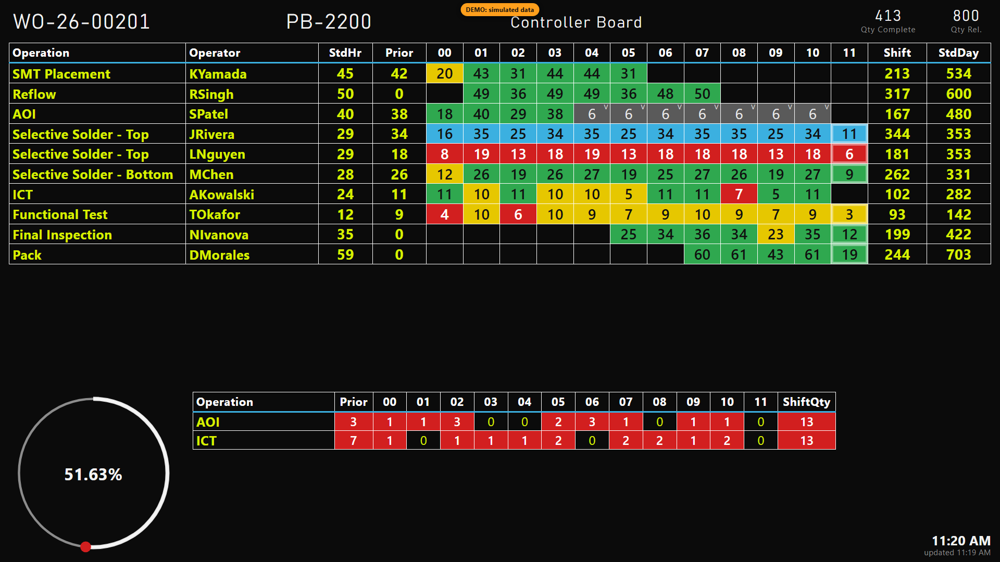
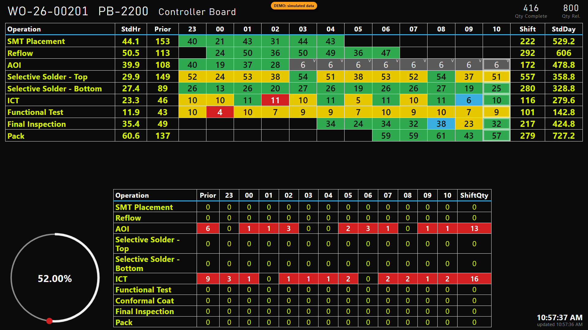
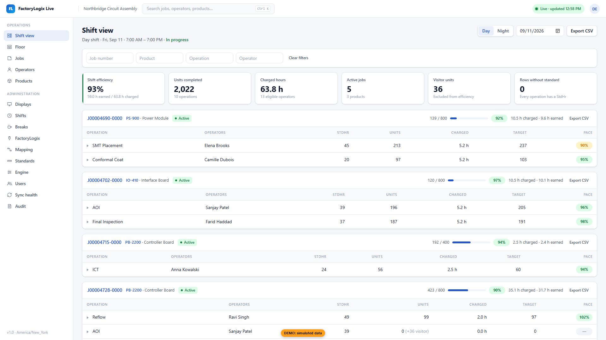
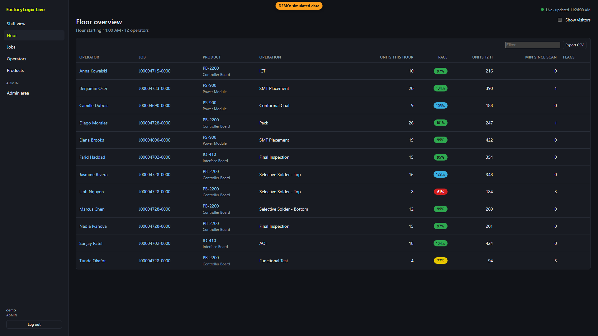
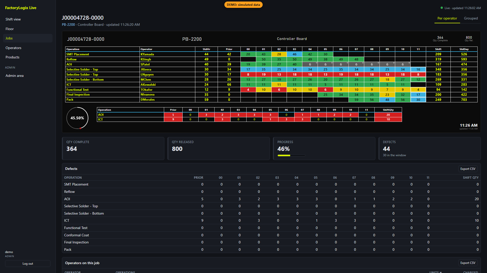
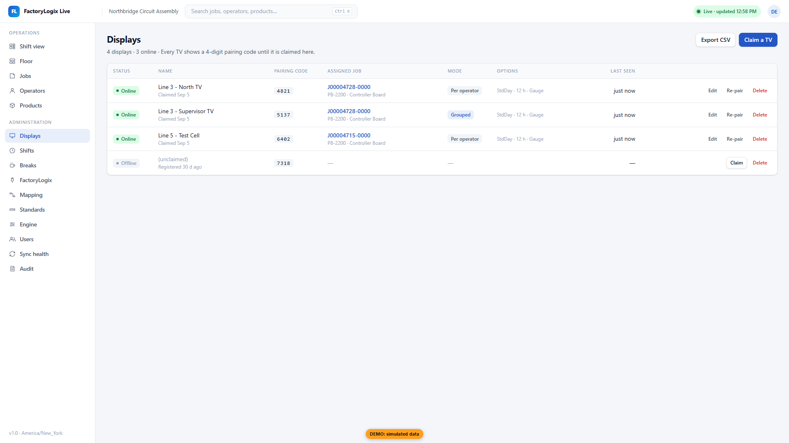

# FactoryLogix Live Production Dashboard and Manager Portal

[](https://github.com/Nathans972/Factory-Logix-Live/actions/workflows/ci.yml)

A standalone, on-premises web application that reads production data out of an Aegis
FactoryLogix MES installation, stores it in its own database, and serves live TV floor
dashboards plus a manager portal with shift views, drill-downs, and admin screens.

## Status

- Built against FactoryLogix's documented OData interface.
- Tested end to end against a simulated FactoryLogix server, not yet against a live
  installation.
- The automated tests, the typecheck and ESLint run in CI on every push and pull request.
- Field mapping, timestamp mode and licensing are verified on install day (see
  [`docs/INSTALL.md`](docs/INSTALL.md) and [`docs/MAPPING.md`](docs/MAPPING.md)).

## What it is

- A **read-only** consumer of FactoryLogix data, polled over OData at a throttled interval
  (default every 90 seconds).
- A **standalone** system with its own PostgreSQL database. Once data is ingested, the
  dashboards and portal keep working even if FactoryLogix is unreachable.
- Self-hosted with Docker Compose on a server or VM your IT team controls.

## What it is not

- It **never writes to FactoryLogix**. The collector uses a read-only account and only ever
  issues `GET` requests against the OData endpoint.
- It is **not multi-tenant** and is not a SaaS product. It is built to run for one company on
  one internal server.
- **If this application fails, FactoryLogix and the factory keep running.** If FactoryLogix
  becomes unreachable, the TVs and portal keep showing the last known data with a "Data
  delayed" banner instead of going blank.

## Screenshots

| TV — separate operators | TV — grouped by operation |
|---|---|
|  |  |

| Portal — shift view | Portal — floor overview | Portal — job detail |
|---|---|---|
|  |  |  |

| Admin — displays |
|---|
|  |

## Live demo

A public demo runs entirely on **simulated data** (a fictional company, fictional products and
operators — never real customer data): **`https://nathans972.github.io/Factory-Logix-Live/`**

`.github/workflows/pages.yml` builds the web app with `VITE_DATA_SOURCE=mock` on every push to
`main` and deploys `apps/web/dist` to GitHub Pages. In mock mode the app runs an in-browser
simulator and calculation engine instead of calling a real backend, and every page carries a
"DEMO: simulated data" badge. Try these paths on the demo:

- `/tv?demo=1` — TV dashboard, one operator per row
- `/tv?demo=2` — TV dashboard, grouped by operation
- `/` — Home: greeting, plant status and a tile per page
- `/shift` — manager portal shift view
- `/floor` — live floor overview
- `/products/PB-2200` — a product's computed standards
- `/displays` — change which job each TV shows
- `/admin` — Settings (the gear in the top bar; changes reset on reload)

The demo signs you in as an admin. Log out and sign in as `kpatterson` (manager) or `floorlead`
(viewer), any password, to see what those roles see; a reload goes back to admin.

## Requirements

- A server or VM on the plant LAN: 4 vCPU, 8 GB RAM, 100 GB disk (recommended).
- Docker and Docker Compose (Docker Engine with the `compose` plugin).
- Network access **from this server to** the FactoryLogix server on port `6065` (OData over
  the Report Scheduler Service). No inbound access from FactoryLogix is needed.
- A **read-only** FactoryLogix user with the minimum rights to read DataMiner data sources.
- FactoryLogix **2019.1 or later**, with the **Report Scheduler Service running** (it also hosts
  the OData endpoint).

See `docs/INSTALL.md` for how to verify these before you start.

## Quick start

```bash
git clone https://github.com/Nathans972/Factory-Logix-Live.git
cd Factory-Logix-Live
cp .env.example .env
```

Edit `.env` and set real secrets. Generate `SESSION_SECRET` and `ENCRYPTION_KEY` with:

```bash
openssl rand -hex 32   # use once for SESSION_SECRET
openssl rand -hex 32   # use once for ENCRYPTION_KEY
```

`ENCRYPTION_KEY` must be exactly 64 hex characters (32 bytes) and `SESSION_SECRET` at least
32 characters — the app validates both at startup and refuses to start otherwise, or while
either is still the public placeholder from `.env.example`. Also set `POSTGRES_PASSWORD` and
`PLANT_TIMEZONE`.

```bash
docker compose up -d
```

Open `http://<host>:8080` and complete the first-run setup wizard (admin user, plant time
zone, FactoryLogix connection, field mapping, shifts, breaks, backfill). See
`docs/INSTALL.md` for the full walkthrough.

## TV setup

Point the TV's browser at `http://<host>:8080/tv` in kiosk / full-screen mode. On first load
it shows a 4-digit pairing code. In the manager portal, go to **Admin > Displays**, enter the
code, name the display, and assign it a job. The TV picks up the assignment within one poll.

## Architecture overview

```
FactoryLogix (OData, port 6065)
        |
        v
   collector  --upserts-->  PostgreSQL (+ TimescaleDB)  <--reads--  api (Fastify, REST + SSE)
   (polls, maps                                                         |
    fields, recomputes)                                    +-----------+-----------+
                                                             v           v           v
                                                        TV (/tv)   Portal (/)   Admin (/admin)
                                                             (served by the web/nginx container)
```

Four Docker Compose services: `db`, `collector`, `api`, `web` (nginx serving the built React
app and reverse-proxying `/api` to `api`). The calculation rules (standards, eligibility,
ownership windows, pace, colors, roll-ups) live in one dependency-free TypeScript package,
`packages/engine`, used by both the server (`api`/`collector`) and the browser (the GitHub
Pages demo), so the numbers you see in the demo and in production come from the same code.

## Repository layout

```
/
  README.md                     this file
  docs/
    SPEC.md                     full product specification
    INSTALL.md                  step-by-step on-prem install
    MAPPING.md                  how to map FactoryLogix data sources
    OPERATIONS.md                backups, upgrades, logs, troubleshooting
    CALCULATIONS.md              plain-language explanation of standards, eligibility, pace, colors
    API.md                       REST/SSE API contract
    ENGINE_NOTES.md               implementation notes for the calculation engine
    WEB_NOTES.md                 implementation notes for the web app
  docker-compose.yml
  .env.example
  packages/
    engine/                     pure TS calculation engine (cells, standards, rollups, time, views)
    shared/                     types, zod schemas, mapping specs, settings defaults
  apps/
    collector/                  OData polling, ingestion, backfill, standards scheduler
    api/                        Fastify REST + SSE, auth, admin endpoints
    web/                        React app: /tv, /, /admin; DataSource abstraction + mock simulator
  db/
    migrations/                 SQL migrations, applied automatically on API start
  .github/workflows/
    ci.yml                      install, build the shared packages, typecheck, lint, every test suite, build the demo
    pages.yml                   build the mock bundle and deploy to GitHub Pages
```

## Development

Requires Node 20+ and pnpm.

```bash
pnpm install
pnpm build:packages        # builds @fld/shared and @fld/engine (needed by every app)
```

Run each service separately during development:

```bash
pnpm dev:api                # apps/api: needs Postgres reachable + DATABASE_URL, SESSION_SECRET,
                             # ENCRYPTION_KEY (and optionally PLANT_TIMEZONE) in its environment
pnpm dev:collector           # apps/collector: needs DATABASE_URL and ENCRYPTION_KEY
pnpm dev:web                 # apps/web: Vite dev server, proxies /api to http://localhost:3001
pnpm dev:web:mock            # apps/web against the in-browser mock simulator; no backend needed
```

Checks used in CI:

```bash
pnpm test                    # unit tests across all packages/apps (engine tests cover spec section 7)
pnpm typecheck                # TypeScript project-wide typecheck
```

## Known issues and roadmap

Known gaps and planned improvements (the hourly late-data re-pull's load, keyset paging,
which extra fields `raw_events` keeps, and TV and cookie hardening) are listed in
[`docs/ROADMAP.md`](docs/ROADMAP.md).

## Further reading

- [`docs/INSTALL.md`](docs/INSTALL.md) — on-premises installation, step by step
- [`docs/MAPPING.md`](docs/MAPPING.md) — mapping FactoryLogix data sources to this app
- [`docs/OPERATIONS.md`](docs/OPERATIONS.md) — backups, upgrades, logs, troubleshooting
- [`docs/CALCULATIONS.md`](docs/CALCULATIONS.md) — standards, eligibility, pace, and colors explained for managers
- [`docs/SPEC.md`](docs/SPEC.md) — the full product specification
- [`docs/API.md`](docs/API.md) — REST/SSE API contract
- [`docs/DESIGN.md`](docs/DESIGN.md) — portal design system (tokens, components, page patterns); approved reference renderings in `docs/design/`
